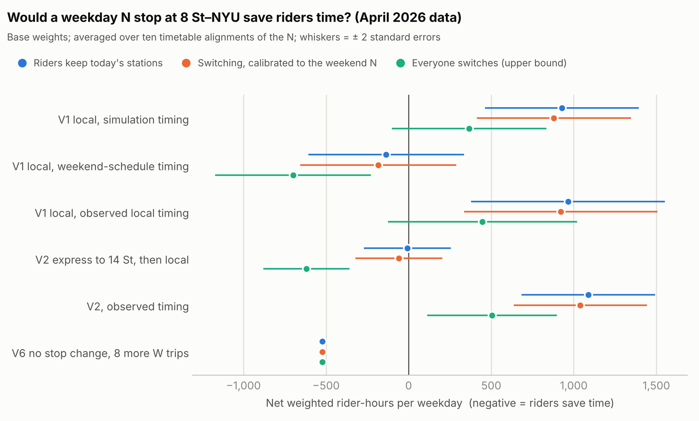

# Why doesn't the N stop at NYU?

*Draft, November 2026.*

Every weekday, N trains roll through 8 St–NYU without stopping. It's the closest subway
station to NYU's Washington Square campus, and the N stops there every weekend. So why not
on weekdays, and would it help if it did?

I'm an NYU student who commutes from Bensonhurst, so I have a stake in the answer. That's
why I wrote down my assumptions before running the numbers ([pre-registration](../preregistration.md))
and published all the code ([repo](https://github.com/devesh-bhayani/n-train-8st)).

## It's a timetable choice, not a track problem

The Broadway line has four tracks. 8 St–NYU only has platforms on the outer two (the local
tracks), and weekday N trains run on the inner two (express) between 34 St and Canal St.
But just south of Prince St there are crossovers between the local and express tracks, and
every weekend the N uses them: it runs local through 28 St, 23 St, 14 St, 8 St and Prince
St, then crosses over to the Manhattan Bridge.

The weekday N did this too, from 2010 to 2016. On November 7, 2016, when the W came back
as part of the Second Avenue Subway changes, the N went back to running express. The local
stations kept the same number of trains (the W replaced the N), but they lost their
one-seat ride from the N's Brooklyn branch.

## When the N left, people stopped getting off there

Turnstile counts from 2016 show what that cost. Compared with nearby stations on other
lines, and with the same weeks of 2015 as a baseline, **exits at 28 St, 23 St, 8 St–NYU and
Prince St fell by about 10%** (95% confidence interval 7–12%) in the weeks after the change.
Entries barely moved: on the way home you can walk to Union Square and catch the N there.
Arriving is where the one-seat ride matters.

## What it costs everyone else

Making the N stop isn't free. Every N rider passing through would sit through four more
stops (28 St, 23 St, 8 St and Prince St) and merge into the R and W on the local tracks.

To measure that, I built a simulation of every train between 57 St and Canal St, replaying
44 real weekdays of observed train movements from [subwaydata.nyc](https://subwaydata.nyc).
It reproduces the real trains' running times within about 2%. With the N running local:

- **N riders** lose about **3 minutes downtown** and **2 minutes uptown**. Uptown is
  cheaper because today's N has to merge into the R/W stream north of 34 St anyway.
- **R and W riders** lose **7–10 seconds** per trip from the extra trains on their tracks.
- **Q riders** gain **26–38 seconds**, because they no longer have to merge with the N.

## The balance

To weigh those costs against the benefits, I built a ledger: Stop the Stop in reverse.
It takes the MTA's estimates of where every weekday subway trip starts and ends (4.2
million trips a day in April 2026), routes each one through today's timetable and
through one where the N runs local, and adds up the difference. Waiting and walking
count double, as they do in most transit appraisals, and each transfer costs an extra
5 minutes.

The result: **a weekday local N would cost riders about 930 rider-hours a day**, give
or take 470. About 800,000 trips change. N riders passing through, and R and W riders
held up a few seconds by the extra trains, lose 5,200 hours between them; riders at
28 St, 23 St, 8 St and Prince St, plus Q riders whose trains no longer merge with the N,
gain 4,300. Spread over everyone affected, that's 4 seconds a trip, in the wrong
direction. Most of the cost lands in the evening rush (3 to 6 pm), when crowds head
downtown, the direction in which a local N loses the most time.

It doesn't hinge on the assumptions. Of 13 combinations of weights (waiting and walking
counted 1.5 to 2.5 times, transfer penalties from 0 to 30 minutes), the stop saves time
in one: when every transfer counts as 30 minutes. The ledger keeps people at today's
stations, which understates the benefit, since some W 4 St and Union Square riders would
switch to 8 St. Letting them switch, as much as riders actually do on weekends when the
N stops there, barely moves it (+880). Even if everyone near campus switched to their
best station, it still costs 370 hours.

What would flip it is speed. If the weekday N could run local as fast as its weekend
schedule (about 2.5 minutes for the four stops), the stop would roughly break even. The
simulation, which puts the N among rush-hour R and W trains, says 3 minutes downtown
and 2 uptown, plus a few seconds for every R and W.

The cheaper versions don't win either. Stopping only at 8 St and Prince St breaks even
at best, and needs a crossover between 14 St and 8 St that may not exist. Adding eight
more of the Sea Beach W trips that already run to 8 St saves 520 hours a day and slows
nobody, but only 2 of those hours go to Sea Beach riders travelling to or from campus.
That W takes 45 minutes from 18 Av, slower than the N and a backtrack; the rest is what
any eight extra trains would buy.

## Keeping the comparison fair

The routing was the easy part. The hard part was making sure today's timetable and the
new one differ only by the stop. A local N reaches Brooklyn three minutes later, so it
no longer meshes with the W, the Q and the R the way today's carefully planned timetable
does. Shift every N train three minutes later, change nothing else, and the ledger
swings by about 4,400 rider-hours. A real timetable would be re-planned around a new
stop, so that swing isn't a cost of stopping at 8 St.

To take it out, every number here is averaged over ten alignments of the N, from nine
minutes earlier to nine minutes later, applied identically to today's timetable and the
new one. The test is a placebo: shift the N with no other change, and the averaged
"effect" should be zero. It comes out at +24 ± 337 rider-hours for a one-minute shift
and +88 ± 830 for three minutes. Getting there took three fixes I didn't expect to need,
written up in the [method notes](../how-it-works.md#three-traps-this-ledger-fell-into-and-how-they-were-found).

## My commute, on real trains

I live between the N at 18 Av and the D at 71 St. Replaying every 2-minute departure from my
door between 6:30 and 10:30 am on 43 real weekdays:

| Route to campus | Median | Slowest 10% |
|---|---|---|
| D to W 4 St | 51.8 min | 59.2 min |
| N, change at Canal for the R/W | 54.8 min | 63.0 min |
| N to 14 St, back down on the R/W | 57.2 min | 66.2 min |
| N to 14 St, walk | 61.5 min | 69.6 min |
| **N one-seat to 8 St (if it stopped)** | **50.1 min** | **57.3 min** |

Two things surprised me. Changing at Canal beats backtracking from 14 St by about 2.5
minutes. And even with a stop at 8 St, the D would still often win for me: the benefit
of the stop is spread across thousands of riders, and it's small for each.

## What would change my mind

- **A faster local.** If the weekday N could run 34 St–Canal local in the 2.5 minutes
  its weekend schedule allows, the stop breaks even; any faster, and it pays. That's a
  question of signals and dwell times at rush hour, which the MTA could test.
- **The crossover.** If there's a crossover between 14 St and 8 St, the shorter
  version (8 St and Prince only) is close to even on schedule timing.
- **A bigger pull to 8 St than weekends show.** Even if every rider near campus
  switched to their best station, the full local still costs time, so this alone
  wouldn't do it.

So the honest answer to my own question is no: on today's best numbers, the weekday N
shouldn't stop at 8 St–NYU, even though I'd be one of the people it helps. All of this
is testable, and the code is open.
